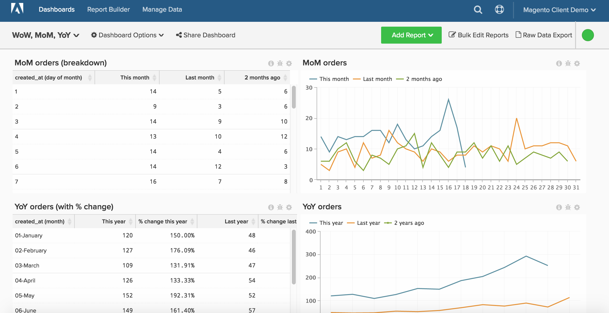

# 기간 간 보고

>[!NOTE]
>
>이 항목에는 원래 아키텍처와 새 아키텍처를 사용하는 클라이언트에 대한 지침이 포함되어 있습니다. 기본 도구 모음에서 [!DNL Manage Data]을(를) 선택한 후 [!DNL _Data Warehouse 보기_] 섹션을 사용할 수 있는 경우 [새 아키텍처](../../administrator/account-management/new-architecture.md)에 있습니다.

Report Builder를 사용하면 시간 경과에 따른 트렌드를 쉽게 확인하고 비교할 기간에 대한 관점을 변경할 수 있습니다. 이 항목에서는 주 단위, 월 단위 및 년 단위 분석을 위한 보고서를 만들 수 있도록 대시보드를 설정하여 더 깊이 있게 구성하는 방법을 보여 줍니다.

시작하기 전에 더 자세한 [여기](../../tutorials/using-visual-report-builder.md) 및 독립 시간 옵션 [여기](../../tutorials/time-options-visual-rpt-bldr.md)를 살펴보십시오.

이 분석에는 [고급 계산 열](../data-warehouse-mgr/adv-calc-columns.md)이(가) 포함되어 있습니다.

## 계산된 열

* **`Sales_flat_order`** 테이블
* **원래 아키텍처:** 아래 열은 분석가가 `[YoY WoW MoM ANALYSIS]` 티켓의 일부로 만듭니다.
* `created_at (month-day)`
* `created_at (month)`
* `created_at (day of the month)`
* `created_at (day of the week)`
* `created_at (hour of the day)`

* **새 아키텍처:** 이 계산을 만드는 방법에 대한 예제 사진과 함께 아래에 나열된 SQL
  * `created_at (month-day)` [!UICONTROL Calculation]: **to_char(A, &#39;mm-dd&#39;)**
  * `created_at (month)` [!UICONTROL Calculation]: **to_char(A, &#39;mm-month&#39;)**
  * `created_at (day of the month)`&lt; [!UICONTROL Calculation]: **to_char(A, &#39;dd&#39;)**
  * `created_at (day of the week)` [!UICONTROL Calculation]: **to_char(A, &#39;d-Day&#39;)**
  * **`created_at (hour of the day)` [!UICONTROL Calculation]: &#x200B;** to_char(A, &#39;hh24&#39;)**
    

## 지표

없음.

>[!NOTE]
>
>새 보고서를 작성하기 전에 [모든 새 열을 지표에 차원으로 추가](../data-warehouse-mgr/manage-data-dimensions-metrics.md)하십시오.

## 보고서

* **전년 대비 차트**
  * [!UICONTROL Metric]&#x200B;: `Number of orders`

  * [!UICONTROL Metric]&#x200B;: `Number of orders`
  * [!UICONTROL Time options]: `Time range (Custom)`: `2 years ago to 1 year ago`

  * [!UICONTROL Show top/bottom]: **`created_at (month-day)`**&#x200B;별로 정렬된 상위 100%*

* 지표 `A`: `This year`
* 지표 `B`: `Last year`
* [!UICONTROL Time period]&#x200B;: `1 year ago to 0 years ago`
* &#x200B;
  [!UICONTROL Interval]&#x200B;: `None`
* [!UICONTROL Group by]&#x200B;: `created_at (month-day)`
* &#x200B;
  [!UICONTROL Chart Type]&#x200B;: `Line`

* **MoM 차트**
  * [!UICONTROL Metric]&#x200B;: `Number of orders`

  * [!UICONTROL Metric]&#x200B;: `Number of orders`
  * 시간 옵션: `Time range (Custom)`: `2 months ago to 1 month ago`

  * 위쪽/아래쪽 표시: **`created_at (day of month)`**&#x200B;별로 정렬된 위쪽 100%*

* 지표 `A`: 이번 달*
* 지표 `B`: 지난 달*
* [!UICONTROL Time period]: 1개월 전부터 0개월 전까지입니다.
* &#x200B;
  [!UICONTROL Interval]&#x200B;: None
* [!UICONTROL Group by]&#x200B;: `created_at (day of month)`
* &#x200B;
  [!UICONTROL Chart Type]&#x200B;: Line

* **너비 차트**
  * [!UICONTROL Metric]&#x200B;: `Number of orders`

  * [!UICONTROL Metric]&#x200B;: `Number of orders`
  * [!UICONTROL Time options]: `Time range (Custom)`: `2 weeks ago to 1 week ago`

  * [!UICONTROL Show top/bottom]: `created_at (day of week)`별로 정렬된 상위 100%

* 지표 `A`: `This week`
* 지표 `B`: `Last week`
* [!UICONTROL Time period]&#x200B;: `1 week ago to 0 weeks ago`
* &#x200B;
  [!UICONTROL Interval]&#x200B;: `None`
* [!UICONTROL Group by]&#x200B;: `created_at (day of week)`
* &#x200B;
  [!UICONTROL Chart Type]&#x200B;: `Line`

* **DoD 차트**
  * [!UICONTROL Metric]&#x200B;: `Number of orders`

  * [!UICONTROL Metric]&#x200B;: `Number of orders`
  * [!UICONTROL Time options]: `Time range (Custom)`: `2 days ago to 1 day ago`

  * [!UICONTROL Show top/bottom]: `created_at (hour of day)`별로 정렬된 상위 100%

* 지표 `A`: `Today`
* 지표 B: `Yesterday`
* [!UICONTROL Time period]&#x200B;: `1 day ago to 0 days ago`
* &#x200B;
  [!UICONTROL Interval]&#x200B;: `None`
* [!UICONTROL Group by]&#x200B;: `created_at (hour of day)`
* &#x200B;
  [!UICONTROL Chart Type]&#x200B;: `Line`

모든 보고서를 컴파일한 후 원하는 대로 대시보드에서 구성할 수 있습니다. 결과는 이 페이지 상단에 있는 이미지와 비슷할 수 있습니다.
