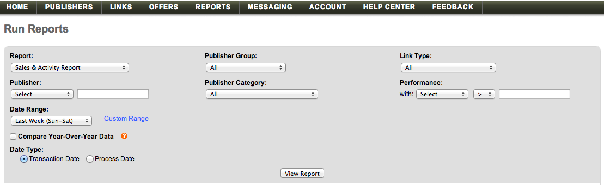

# [!DNL Linkshare] 데이터 가져오기

[!DNL Linkshare] 데이터를 [!DNL Adobe Commerce Intelligence]&#x200B;(으)로 가져오려면 다음 두 가지 작업을 수행해야 합니다.

1. [Linkshare 데이터를 `.csv` 형식으로 내보내기](#export)
1. [스프레드시트를  [!DNL Commerce Intelligence]에 업로드](../connecting-data/using-file-uploader.md)

## Linkshare에서 데이터 내보내기 {#export}

1. [!DNL Linkshare] 계정에서 **[!UICONTROL Reports** > **Run Reports].**(으)로 이동

1. `Report` 드롭다운에서 **[!UICONTROL Sales & Activity Report]**&#x200B;을(를) 선택합니다.

1. 다른 모든 드롭다운 옵션을 기본 선택으로 둡니다.

1. `Date Range` 드롭다운에서 [!DNL Commerce Intelligence]의 `Start of Week` 설정과 일치하는 옵션(`Sun - Sat`, `Mon - Sun`)을 선택합니다.

1. `Compare Year-Over-Year Data` 확인란의 선택을 취소합니다.

1. `Data Type`에서 `Transaction Date`을(를) 선택합니다.

   

1. **[!UICONTROL View Report]**&#x200B;을(를) 클릭합니다.

1. **[!UICONTROL Download]**&#x200B;을(를) 클릭합니다.

   이 시점에서 `.csv` 파일을 다운로드했습니다.

파일을 다운로드한 후 [`File Upload` 기능](../connecting-data/using-file-uploader.md)을 사용하여 [!DNL Commerce Intelligence]에 업로드할 수 있습니다.
