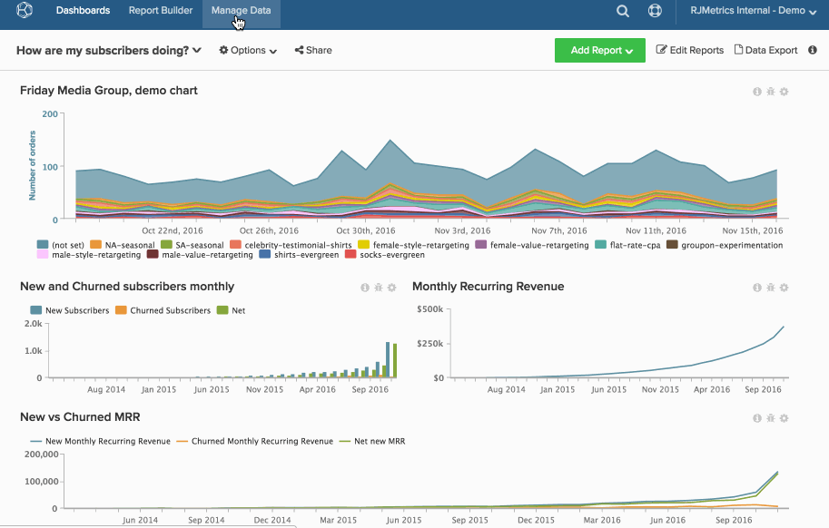

# 차트를 영구적으로 삭제

[대시보드에서 차트를 제거](../../data-user/dashboards/remove-charts-dashboard.md)해도 [!DNL Commerce Intelligence] 계정에 남아 있습니다.

차트를 영구적으로 삭제하려면 다음을 수행합니다.

1. 사이드바에서 **[!UICONTROL Account Setting]**&#x200B;을(를) 클릭합니다.

1. **[!UICONTROL Charts]**&#x200B;을(를) 클릭합니다.

1. 사용자 권한 및 차트 소유권에 따라 삭제할 수 있는 차트가 화면 오른쪽에 표시됩니다.

1. 삭제할 차트 선 옆의 확인란을 클릭합니다.

1. **[!UICONTROL Delete Selected]**&#x200B;을(를) 클릭합니다.

   >[!NOTE]
   >
   >차트가 대시보드 또는 이메일 요약에 사용되는 경우 알림이 표시됩니다. 계속하려면 삭제를 확인한 다음 **[!UICONTROL Force Deletion]**&#x200B;을(를) 클릭합니다.

예:

<!--{: width="630" height="402"}-->
