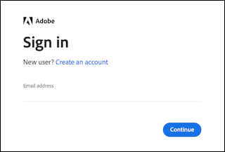

# 활성화된 [!DNL Adobe Commerce Intelligence] 계정에 액세스

[온-프레미스 또는 클라우드](../getting-started/onpremise-activation.md)에 대해 [!DNL Commerce Intelligence] 계정을 활성화하고 Adobe 계정 팀과 함께 구성 단계를 완료하면 이제 계정에 로그인할 수 있습니다.

## [!DNL Adobe ID]을(를) 사용하여 로그인

1. **[!UICONTROL Sign in with Adobe ID]**&#x200B;을(를) 클릭합니다.

   

1. [!DNL Commerce Intelligence] 계정을 만들 때 사용한 전자 메일 주소를 입력하십시오. Adobe 계정이 아직 없는 경우 **[!UICONTROL Create an account]**&#x200B;을(를) 클릭하고 정보를 입력하십시오. [!DNL Commerce Intelligence] 계정을 만들 때 사용한 전자 메일 주소를 사용하십시오. 이메일 주소는 Adobe 계정에 액세스하는 데 필요한 키입니다.

>[!NOTE]
>
>[!DNL Adobe ID]을(를) 사용하여 로그인하면 [!DNL Commerce Intelligence] 프로필 암호를 변경할 수 없습니다.

## 사용자 이름 및 암호를 사용하여 로그인

전자 메일 주소와 암호를 입력하고 **[!UICONTROL Sign In]**&#x200B;을(를) 클릭합니다.

이제 [!DNL Commerce Intelligence]에 액세스할 수 있습니다.
